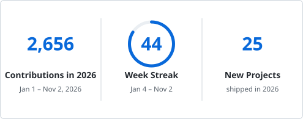

# Hi, I'm Harry👋

**Senior Front-end Engineer** · 7+ years · Tokyo 🇯🇵 
Building small, practical products at the intersection of **AI × Language Learning × Developer Tools**. 
🇯🇵 東京在住のフロントエンドエンジニア（7年以上）。AI・語学学習・開発者ツールの交差点で、日常的に使える小さなプロダクトを作っています。

**What I'm good at** — scaling front-end systems, modernizing legacy platforms, and shipping tools people use daily. 
🇯🇵 得意分野：フロントエンドのスケーリング、レガシー基盤のモダナイズ、そして「毎日使われる」ツールを届けること。

      

## 🔥 Featured Projects ・ 主なプロジェクト

**🎌 Language Learning ・ 語学学習** — all at [nihongo.day](https://nihongo.day/)

- 🧩 **[Katachi](https://katachi.nihongo.day/)** — Japanese conjugation trainer for mastering core grammar forms through focused practice.
   🇯🇵 日本語の活用形を集中的な反復練習でマスターするトレーナー。
- 🎧 **[Shadowing](https://shadowing.nihongo.day/)** — Desktop player for repeat listening and shadowing your own audio: A‑B loops, sentence-by-sentence practice, recording, and transcription. macOS and Windows.
   🇯🇵 手持ちの音声で聞き込みとシャドーイングをするデスクトップアプリ。A‑B リピート、文ごとの練習、録音、文字起こしに対応（macOS・Windows）。
- ⚔️ **[kanji-kaisen](https://kanji-kaisen.nihongo.day/learn)** — Gamified kanji learning combining spaced repetition with stroke recognition.
   🇯🇵 間隔反復と筆順認識を組み合わせた、ゲーム感覚の漢字学習アプリ。
- 🏠 **[Nichijō](https://nichijo.nihongo.day/)** — What's this called in Japanese? One everyday object or action at a time, with its name and a phrase you can use.
   🇯🇵 「これ、日本語で何ていう？」身近なモノや動作を一つずつ、名前と使える表現で紹介。
- 🔍 **[PhraseLens](https://phrase-lens.nihongo.day/)** — Native macOS AI language workspace and in-context translation assistant with Vision OCR, TTS, and multi-model support.
   🇯🇵 選択テキストの即時翻訳・OCR・要約・音声合成に対応した、ネイティブ macOS 向け AI 語学ワークスペース。

**🛠️ Developer Tools ・ 開発者ツール**

- 🎹 **[KeyChord](https://github.com/mxggle/key-chord)** — Native macOS menu-bar app for global hotkey app switching, without Accessibility permissions.
   🇯🇵 アクセシビリティ権限なしでグローバルホットキーによるアプリ切替ができる macOS メニューバーアプリ。

**🎴 Learning materials I built ・ 自作の学習教材**

- [**JLPT N2 Grammar Deck**](https://github.com/mxggle/anki-jlpt-n2-grammar-example-sentences) — Anki deck with example sentences and audio.
- [**JLPT N1 Grammar Deck**](https://github.com/mxggle/anki-jlpt-n1-grammar-example-sentences) — Anki deck with example sentences and audio.
- [**Shin Kanzen Master N3 Grammar**](https://ankiweb.net/shared/info/443240925) — Sentence deck with structured lesson coverage and audio.

🇯🇵 JLPT N1・N2・N3 向けの Anki デッキ。例文と音声付き、レッスン単位で構成。

## 📊 Shipping ・ アウトプット

<picture>
  <source media="(prefers-color-scheme: dark)" srcset="https://raw.githubusercontent.com/mxggle/mxggle/main/assets/stats-dark.svg">
  
</picture>

<picture>
  <source media="(prefers-color-scheme: dark)" srcset="https://github-readme-activity-graph.vercel.app/graph?username=mxggle&theme=github-compact&hide_border=true&hide_title=true&area=true">
  
</picture>

Shipping steadily across TypeScript, Swift, Python and Rust — mostly small products I use every day.
 🇯🇵 TypeScript・Swift・Python・Rust を横断して、毎日自分で使う小さなプロダクトを作り続けています。

## 🌍 Languages ・ 語学

| Language ・ 言語 | Level ・ レベル |
|---|---|
| 🇨🇳 Mandarin | Native ・ 母語 |
| 🇺🇸 English | Professional working proficiency (CEFR B2) ・ ビジネスレベル |
| 🇯🇵 Japanese | JLPT N2, pursuing N1 ・ N1 取得に向けて学習中 |

---

🎯 Currently: going deeper on applied AI engineering, and building tiny tools that compound over time.
 🇯🇵 現在は応用 AI エンジニアリングを深めながら、積み重なる小さなツールを作り続けています。
